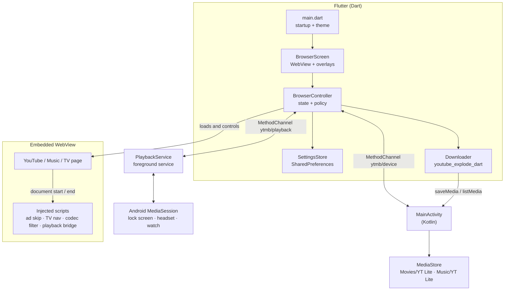

<div align="center">


# YT Lite

**YouTube and YouTube Music as a native-feeling Android app — ads skipped, remote-ready, and built to stay fast on low-end TVs.**

A thin Flutter shell around `m.youtube.com`, `music.youtube.com`, and `youtube.com/tv`, powered by an embedded WebView and a small amount of native Android code.

[](https://flutter.dev)
[](https://dart.dev)
[-3DDC84?logo=android&logoColor=white&style=flat-square)](#installation)
[](pubspec.yaml)
[](#two-apps-one-codebase)

[Overview](#overview) · [Features](#key-features) · [Architecture](#architecture) · [Installation](#installation) · [Usage](#usage) · [Configuration](#configuration) · [Contributing](#contributing)

</div>

---

> **Project status:** early-stage (`0.1.0`), Android-only, and distributed as source plus prebuilt APKs. There is no CI pipeline, release keystore, or license file in the repository yet — see [Roadmap](#roadmap) and [License](#license).

## Contents

- [Overview](#overview)
- [Key Features](#key-features)
- [Two Apps, One Codebase](#two-apps-one-codebase)
- [Architecture](#architecture)
- [Tech Stack](#tech-stack)
- [Project Structure](#project-structure)
- [Installation](#installation)
- [Quick Start](#quick-start)
- [Usage](#usage)
- [Configuration](#configuration)
- [Examples](#examples)
- [Known Limitations](#known-limitations)
- [Roadmap](#roadmap)
- [Contributing](#contributing)
- [License](#license)
- [Acknowledgements](#acknowledgements)

## Overview

YouTube's mobile website works in a browser, but it is not an app: it has browser chrome, interrupts playback when backgrounded, shows ads, and rejects Google sign-in inside a plain Android WebView. On a TV, the web player is effectively unusable with a remote control.

**YT Lite** solves this by hosting YouTube's own web clients inside a `flutter_inappwebview` surface and adding the pieces the website lacks:

- **App-like presentation** — the page fills the screen with no URL bar or browser toolbar; on phones the only browser chrome is a 3 px loading bar.
- **Ad removal inside the page** — player responses are stripped and leftover ads are skipped without routing traffic through a proxy.
- **Background audio and system media controls** — a foreground service exposes a `MediaSession`, so lock-screen, headset, and watch controls work.
- **Sign-in that survives WebView detection** — the user agent is sanitized and a desktop fallback is tried once if Google still refuses.
- **A real TV experience** — YouTube's `/tv` interface, D-pad focus management, leanback launcher entry, and an H.264 playback path (AV1/VP9 masked) for hardware decoding.
- **YouTube-style downloads (phone)** — a **Download** row in a video's ••• menu opens a quality sheet (4K down to 360p, or audio only), and a **Downloads** row on the You tab opens an in-app library laid out like YouTube's. See [Known limitations](#known-limitations): the transfer step is currently blocked by YouTube.

Everything runs locally on the device; there is no backend, account system, or telemetry.

## Key Features

| Feature | What the app actually does |
|---|---|
| **In-page ad blocking** | Injects a script that deletes ad fields (`adPlacements`, `playerAds`, `adSlots`, …) from player responses, prunes sponsored renderers from feed/search JSON, hides ad containers with CSS, and clicks Skip / mutes / fast-forwards any ad that still appears. Best effort; enabled by default. |
| **Background playback** | Hides page visibility state, reports playback to a native foreground service every 3 s, and publishes title/artist plus play, pause, next, and previous to the Android media session. Phone builds only. |
| **Google sign-in** | Removes `; wv` and `Version/4.0` from the WebView user agent, loads popup sign-in in the main WebView so cookies are shared, and retries once with a desktop Chrome UA when Google returns `403 disallowed_useragent` or its "browser not secure" page. |
| **Downloads** | Injects a **Download** row into the mobile site's ••• sheet and a **Downloads** row on the You tab. The quality sheet lists only streams that actually answer a ranged request (video 360p–4K as MP4, audio as AAC/M4A, no AV1), pre-selects the best, and can remember the choice for 30 days. Chosen tracks are fetched in ranged chunks, joined without re-encoding by a native `MediaMuxer`, and published to `MediaStore`. The library screen shows thumbnails, durations, sizes and device storage. Phone builds only; see [Known limitations](#known-limitations). |
| **Theme sync** | Phone setting for System / Dark / Light. The choice is applied to Flutter, to the native `uiMode`, and to YouTube's own `PREF` cookie (`f6` bit `0x400`); the activity is recreated to apply it. |
| **TV-first interaction** | Injected navigation engine moves a visible focus highlight with the D-pad, sends Escape for BACK, uses real touch events for custom YouTube buttons, and opens Settings from the remote's MENU key. |
| **Codec fallback for TVs** | Reports AV1, VP9, and VP8 as unsupported so YouTube serves H.264, which low-end TV chips decode in hardware. |
| **Startup performance** | Settings and device info load in parallel, and the user agent is assembled natively from the installed WebView version on Android 8+ instead of loading Chromium before the first frame. |
| **Navigation allowlist** | Only `https` top-level navigations to YouTube and Google hosts are permitted; anything else is cancelled and surfaced to the user as `Blocked: <host>`. |
| **Error recovery** | Main-frame failures show a full-screen "Can't reach YouTube" view with Retry, falling back to the home page when there is nothing to reload. |

## Two Apps, One Codebase

Two Android product flavors build two separate applications from the same Dart code.

| | **YT Lite** | **YT Lite TV** |
|---|---|---|
| Flavor | `mobile` | `tv` |
| Application ID | `com.custom.youtubemusicbrowser.mobile` | `com.custom.youtubemusicbrowser` |
| Launcher | Standard `LAUNCHER` entry | `LEANBACK_LAUNCHER` plus `LAUNCHER` for sideload launchers |
| Home page | `https://m.youtube.com/` | `https://www.youtube.com/tv` |
| Input model | Touch; BACK prompt with a **MENU** action | D-pad and remote keys; MENU opens Settings |
| Theme | System / Dark / Light | Always dark |
| Downloads, background playback | Yes (download UI is native and styled like YouTube's) | No (hidden; no background audio) |
| Output APK | `app-mobile-release.apk` | `app-tv-release.apk` |

The flavor selects the interface at compile time through `FLUTTER_APP_FLAVOR` (see `lib/app_flavor.dart`). Device detection is only a fallback for unflavored development builds.

## Architecture

YT Lite has four cooperating layers: Flutter UI and state, injected page scripts, native Android services, and the WebView itself.



**Startup sequence**

1. `main()` loads `SettingsStore` and device info (TV flag, SDK level, fast user agent) concurrently through `ytmb/device`.
2. The flavor decides TV vs. phone; an unflavored build falls back to device detection.
3. `BrowserController` is created with the initial user agent, and `BrowserScreen` hosts the WebView.
4. On load, the controller selects scripts per build: codec filter and TV navigation on TV, playback bridge on phone, ad skipper when enabled.

**Component responsibilities**

| Component | Responsibility |
|---|---|
| `lib/main.dart` | Parallel startup, WebView debugging flag, theme and orientation setup, `MaterialApp`. |
| `lib/browser/browser_controller.dart` | Single source of truth: navigation policy, user-agent switching, user scripts, playback/MediaSession bridge, history state, theme cookie, data clearing. |
| `lib/browser/browser_screen.dart` | WebView widget wiring, phone back-press UX, download progress bar and quality sheet, Downloads screen routing, error view, TV splash and focus handoff. |
| `lib/browser/mobile_page.dart` | Phone-only injected script: adds the Download row to the ••• sheet, adds the Downloads row to the You tab, and reports the page's light/dark state so system bars match. |
| `lib/browser/tv_player.dart`, `lib/browser/tv_display.dart` | TV-only injected scripts: instant 10 s seeking and voice-search button; 1920 px layout viewport and higher-resolution thumbnails. |
| `lib/browser/domain_filter.dart` | Top-level navigation allowlist, auth detection, TV-site and Music detection, TV user-agent decisions. |
| `lib/browser/yt_ad_skipper.dart` | `fetch` / `JSON.parse` / `ytInitialPlayerResponse` hooks, CSS hiding, 1 s runtime skipper. |
| `lib/browser/tv_navigation.dart` | Spatial D-pad navigation, focus highlight, activation via click or native tap, Escape/back handling. |
| `lib/browser/codec_filter.dart` | Masks AV1/VP9 in MediaSource, `canPlayType`, and `mediaCapabilities`. |
| `lib/browser/user_agent.dart` | UA sanitizing, desktop fallback, TV UA construction. |
| `lib/settings/` | Preference storage, theme dropdown, `PREF` cookie bit manipulation. |
| `lib/download/` | `downloader.dart` (stream selection, servability check, ranged transfer, file naming, progress), `download_sheet.dart` (YouTube-style quality sheet), `downloads_screen.dart` (library with thumbnails, durations, storage bar, delete/play). |
| `android/.../MainActivity.kt` | Method channels, fast UA, TV key dispatch and native taps, video/audio muxing, MediaStore save/list/thumbnail/delete/play, device storage info, voice recognition, activity restart. |
| `android/.../PlaybackService.kt` | Foreground media service, notification, wake lock, `MediaSession` callbacks. |

## Tech Stack

| Layer | Technology | Version in this repo |
|---|---|---|
| App framework | Flutter (Material 3) | Dart `^3.13.4`, Flutter `>=3.44.0` |
| Language | Dart, Kotlin | Dart 3.13.4, Kotlin 2.2.20 |
| WebView | `flutter_inappwebview` | 6.1.5 |
| Preferences | `shared_preferences` | 2.5.6 |
| Media extraction | `youtube_explode_dart` | 3.1.0 |
| Android build | Gradle (Kotlin DSL), AGP | Gradle 8.14, AGP 8.13.0, Java 17 |
| Android platform | Min SDK 24, target/compile from Flutter | API 24+ (Android 7.0+) |
| Testing / linting | `flutter_test` (SDK), `flutter_lints` | `flutter_lints` 6.0.0 |

No state-management, routing, or dependency-injection packages are used beyond the Flutter SDK and the packages above.

## Project Structure

```text
.
├── lib/
│   ├── main.dart                     # entry point, startup work, theme, MaterialApp
│   ├── app_flavor.dart               # mobile/tv switch from FLUTTER_APP_FLAVOR
│   ├── browser/
│   │   ├── browser_controller.dart   # state, navigation policy, scripts, channels
│   │   ├── browser_screen.dart       # WebView host, back UX, download UI, errors
│   │   ├── domain_filter.dart        # https allowlist + auth/TV/Music detection
│   │   ├── user_agent.dart           # WebView-marker stripping, desktop/TV UAs
│   │   ├── yt_ad_skipper.dart        # injected ad removal
│   │   ├── mobile_page.dart          # injected phone tweaks: Download row, You-tab row, theme
│   │   ├── tv_navigation.dart        # injected D-pad/focus engine
│   │   ├── tv_player.dart            # injected TV seek + voice-search button
│   │   ├── tv_display.dart           # injected TV viewport + thumbnails
│   │   └── codec_filter.dart         # injected codec list for TVs
│   ├── download/
│   │   ├── downloader.dart           # stream selection, ranged transfer, muxing handoff
│   │   ├── download_sheet.dart       # YouTube-style quality sheet
│   │   └── downloads_screen.dart     # library: thumbnails, durations, storage bar
│   ├── settings/
│   │   ├── settings_store.dart       # SharedPreferences keys
│   │   ├── settings_screen.dart      # settings list (TV-aware focus)
│   │   └── theme_pref.dart           # YouTube PREF cookie dark bit
│   └── widgets/
│       └── loading_indicator.dart    # isolated 3 px progress bar
├── android/
│   ├── app/build.gradle.kts          # flavors, minSdk 24, package IDs
│   └── app/src/main/kotlin/com/custom/youtubemusicbrowser/
│       ├── MainActivity.kt           # channels, TV input, MediaStore
│       └── PlaybackService.kt        # foreground service + MediaSession
├── test/                             # unit tests for filters, downloads, theme, UA
├── pubspec.yaml                      # dependencies and app version
└── .gitignore                        # *.apk is ignored; binaries ship via GitHub Releases
```

Prebuilt APKs are not stored in the repository. Download them from the [Releases page](https://github.com/pranjal030404/Free_Youtube/releases), or build from source below.

## Installation

### Requirements

| Requirement | Notes |
|---|---|
| Flutter SDK | Stable, `>= 3.44.0` (declared by `pubspec.lock`) |
| Dart | `>= 3.13.4 < 4.0.0` |
| JDK | 17 (source/target compatibility is set to Java 17) |
| Android SDK | Platform and build tools compatible with AGP 8.13.0 |
| Device / emulator | Android 7.0 (API 24) or newer with a system WebView |

### Prebuilt APKs

Download `YTLite-mobile.apk` (phone) or `YTLite-tv.apk` (Android TV) from the [Releases page](https://github.com/pranjal030404/Free_Youtube/releases) and install with `adb install -r <file>` or by opening the file on the device (allow installs from unknown sources).

### From source

```sh
git clone https://github.com/pranjal030404/Free_Youtube.git
cd Free_Youtube

flutter pub get
flutter analyze
flutter test
```

`android/local.properties` is git-ignored and created by the Flutter tool on first build; it holds your local `sdk.dir` and `flutter.sdk` paths. Do not commit it.

## Quick Start

Run either flavor on a connected device or emulator:

```sh
# Phone / tablet build
flutter run --flavor mobile

# Android TV build (use a TV device or emulator)
flutter run --flavor tv
```

Build release APKs:

```sh
# Phone: 32-bit ARM + ARM64
flutter build apk --release --flavor mobile --target-platform android-arm,android-arm64

# TV: 32-bit ARM (smaller APK)
flutter build apk --release --flavor tv --target-platform android-arm
```

Outputs:

```text
build/app/outputs/flutter-apk/app-mobile-release.apk
build/app/outputs/flutter-apk/app-tv-release.apk
```

Install with ADB:

```sh
adb install -r build/app/outputs/flutter-apk/app-mobile-release.apk
adb install -r build/app/outputs/flutter-apk/app-tv-release.apk
```

> A flavor is always required. Release builds currently use the debug signing config (`android/app/build.gradle.kts`), so they are installable but not suitable for Play Store distribution as-is.

## Usage

### Phone

| Action | How |
|---|---|
| Browse | Open the app; it loads `m.youtube.com`. |
| Go back | System BACK navigates the WebView history. |
| Exit | BACK at the first page shows "Press back again to exit" with a **MENU** action; press BACK again within 3 seconds. |
| Settings | **MENU** in that prompt. |
| Download | Tap ••• on a video (feed, search, or watch page) → **Download** → pick a quality or **Audio only** → **Download**. Progress shows at the bottom of the screen. |
| Open downloads | **You** tab → **Downloads** (above *Your videos*), or Settings → **Downloads**. |
| Switch to Music | Settings → **YouTube Music**; return with Settings → **YouTube home**. |
| Change theme | Settings → **Theme** → System / Dark / Light. The screen restarts to apply it. |
| Toggle ad blocking | Settings → **Ad blocking**. The page reloads for the change to apply. |
| Sign out / reset | Settings → **Clear cookies & site data**. Then the home page reloads. |
| Background audio | Start playback, then leave the app or turn the screen off. Use the notification, lock screen, headset, or watch controls. |
| Fullscreen | Enter the player's fullscreen; the app switches to immersive mode and allows rotation. |

### Android TV

| Action | How |
|---|---|
| Navigate | D-pad moves the white focus outline; OK selects. |
| Play / pause | OK on the player. Press OK twice quickly for fullscreen. |
| Seek | Left / Right on the focused player seeks ±10 seconds. |
| Back | BACK is delivered to the page as Escape. At the YouTube TV root, press it twice within 2 seconds to exit. |
| Settings | Remote **MENU**, **SETTINGS**, or **TV contents menu** key. |
| Sign in | Settings → **Google sign-in**, or the site's own sign-in. Google's email/password fields focus automatically; OK opens the on-screen keyboard. |
| Music | Settings → **YouTube Music** (this uses the regular mobile user agent). |

The first TV launch shows a one-time hint about D-pad, OK, and MENU.

### Signing in

Google sometimes blocks embedded browsers. The app mitigates this in three ways:

1. The WebView user agent is sanitized to remove `; wv` and `Version/4.0`.
2. Popup sign-in windows are loaded in the main WebView so the resulting cookies apply to the page.
3. If Google returns a 403 or its "This browser or app may not be secure" page, the sign-in page is retried once with a desktop Chrome user agent that preserves the installed Chrome version.

Use Settings → **Google sign-in** for a direct entry point. The flow is wired to create a YouTube session (`service=youtube`), so YouTube Music opens signed in.

### Downloads

- **Video** — every quality YouTube lists for the video (up to 2160p / 4K) is offered when it can be fetched; the highest is pre-selected. H.264 and VP9 video are joined with the best AAC audio into one MP4 using Android's `MediaMuxer`, without re-encoding. AV1 is skipped.
- **Audio only** — the highest-bitrate AAC track, saved as `.m4a`.
- **Where files go** — on Android 10+ they are published through `MediaStore` into `Movies/YT Lite` or `Music/YT Lite`, so they also appear in the gallery and music apps. On Android 9 and older they go to the app-specific external `Movies`/`Music` folder.
- **Library** — lists the app's downloads with thumbnails, duration, quality and size, shows device storage, and offers Play and Delete from each row's ⋮ menu.

The TV build has no download UI. See [Known limitations](#known-limitations) before relying on this feature.

## Known limitations

- **Downloads currently stop after about 1 MB.** The stream links obtained through `youtube_explode_dart` are refused (HTTP 403) or stall once a request goes past the first megabyte; YouTube now expects a proof-of-origin token that this client cannot supply. The menu row, quality sheet, progress bar and library are complete, but a full download does not finish on the tested device (OnePlus Nord, Android 12). Fixing this needs a supported way to obtain playable stream URLs and is not solved in this repository.
- **Opus and 240p-and-below tracks are not offered**, because the same restriction applies to them.
- **60 fps on TV** is dropped by the WebView on the tested TV (about a quarter of frames), so the TV build declines above 30 fps.
- **Prebuilt APKs** are published on [GitHub Releases](https://github.com/pranjal030404/Free_Youtube/releases) and may lag the source.
- **Release signing** uses the debug key.

## Configuration

There are no `.env` files, config files, or backend endpoints. Configuration is split between compile-time flags and three `SharedPreferences` values.

### Runtime preferences

| Key | Type | Default | Controlled from |
|---|---|---|---|
| `ad_blocking_enabled` | `bool` | `true` | Settings → Ad blocking |
| `theme_mode` | `'system' \| 'light' \| 'dark'` | `'system'` | Settings → Theme (phone only) |
| `tv_hint_shown` | `bool` | `false` | Set automatically after the first TV launch |

Flutter stores these under the `FlutterSharedPreferences` file with a `flutter.` prefix; `MainActivity.attachBaseContext` reads `flutter.theme_mode` natively so the activity starts in the right night mode. Keep the key names and values in sync if you change them.

### Compile-time flags

| Flag | Effect | Example |
|---|---|---|
| `--flavor mobile` / `--flavor tv` | Required. Selects package ID, label, launcher, home page, and feature set. Sets `FLUTTER_APP_FLAVOR`. | `flutter build apk --flavor tv` |
| `--dart-define=WEBVIEW_DEBUG=true` | Enables WebView remote debugging outside debug builds (debug builds enable it via `kDebugMode`). | `flutter run --flavor mobile --dart-define=WEBVIEW_DEBUG=true` |
| `--target-platform` | Restricts ABIs. The documented TV build uses `android-arm` only. | `--target-platform android-arm` |

### Network policy

Only top-level `https` navigations to these hosts are allowed:

- `youtube.com` and subdomains (`www`, `m`, `music`, `accounts`, `consent`, …), `youtu.be`, `youtube-nocookie.com`
- `google.com` and its country domains (for example `google.co.in`, `google.co.uk`)

Sub-resource requests and iframe navigations are not filtered by this policy. Non-allowlisted top-level navigations are cancelled with a `Blocked: <host>` notice.

## Examples

### Detect a downloadable video ID

`videoIdOf` only accepts 11-character IDs on `youtube.com` watch and Shorts URLs:

```dart
import 'package:youtubemusicbrowser/download/downloader.dart';

videoIdOf(Uri.parse('https://m.youtube.com/watch?v=jNQXAC9IVRw&t=3'));
// 'jNQXAC9IVRw'

videoIdOf(Uri.parse('https://example.com/watch?v=jNQXAC9IVRw'));
// null
```

### Set YouTube's dark-mode cookie bit

`prefWithDark` edits only the `f6` field and preserves everything else:

```dart
import 'package:youtubemusicbrowser/settings/theme_pref.dart';

prefWithDark('tz=UTC&f4=4000000', dark: true);
// 'tz=UTC&f4=4000000&f6=400'

prefWithDark('tz=UTC&f6=40000400', dark: false);
// 'tz=UTC&f6=40000000'
```

### Sanitize a WebView user agent

```dart
import 'package:youtubemusicbrowser/browser/user_agent.dart';

UserAgents.sanitize(
  'Mozilla/5.0 (Linux; Android 10; K; wv) AppleWebKit/537.36 '
  '(KHTML, like Gecko) Version/4.0 Chrome/126.0.6478.122 Mobile Safari/537.36',
);
// Mozilla/5.0 (Linux; Android 10; K) AppleWebKit/537.36
// (KHTML, like Gecko) Chrome/126.0.6478.122 Mobile Safari/537.36
```

### Run the checks

```sh
flutter analyze   # No issues found!
flutter test      # 10 tests across 4 files
```

## Roadmap

No roadmap, milestone list, or issue labels are defined in this repository. `android/app/build.gradle.kts` still contains template TODOs for the application ID and release signing; release builds are signed with the debug key.

The following are **suggestions only, not committed plans**:

- Add a release keystore and `key.properties` configuration.
- Add CI for `flutter analyze`, `flutter test`, and both flavored builds.
- Commit phone and TV screenshots (none are present today).
- Restore full-length downloads once a supported way to obtain playable stream URLs is available (see Known limitations).
- Add a `LICENSE` file before distributing the project publicly.

## Contributing

There is no `CONTRIBUTING.md`, issue template, or CI workflow yet, so the workflow is:

1. Fork `https://github.com/pranjal030404/Free_Youtube` and create a topic branch.
2. Make the change without altering unrelated files.
3. Run the checks:

   ```sh
   flutter pub get
   flutter analyze
   flutter test
   ```

4. Verify the affected flavor manually (`--flavor mobile` or `--flavor tv`); several behaviors differ per flavor.
5. Open a pull request describing the change, the flavor(s) affected, and how you tested on a device.

Style follows `flutter_lints` (`analysis_options.yaml`). Keep ad-skipping and TV-navigation scripts defensive: YouTube changes its DOM and API payloads without notice.

## License

**No license file is present in this repository.** Without an explicit license, default copyright applies, so others do not automatically receive permission to use, modify, or redistribute the code. If you intend the project to be open source, add a `LICENSE` file (for example, via [choosealicense.com](https://choosealicense.com/)) and update this section.

## Acknowledgements

Built on the work of:

- [Flutter](https://flutter.dev) and the Material 3 design system
- [InAppWebView](https://inappwebview.dev) — the embedded browser surface and user-script APIs
- [youtube_explode_dart](https://pub.dev/packages/youtube_explode_dart) — stream manifest access for downloads
- [shared_preferences](https://pub.dev/packages/shared_preferences) — local settings
- YouTube / YouTube Music, whose web clients the app embeds

**Contact:** open an issue at [pranjal030404/Free_Youtube](https://github.com/pranjal030404/Free_Youtube/issues) or reach the maintainer on GitHub at [@pranjal030404](https://github.com/pranjal030404).

<div align="center">
<sub>YT Lite is an unofficial client and is not affiliated with or endorsed by YouTube or Google.</sub>
</div>
